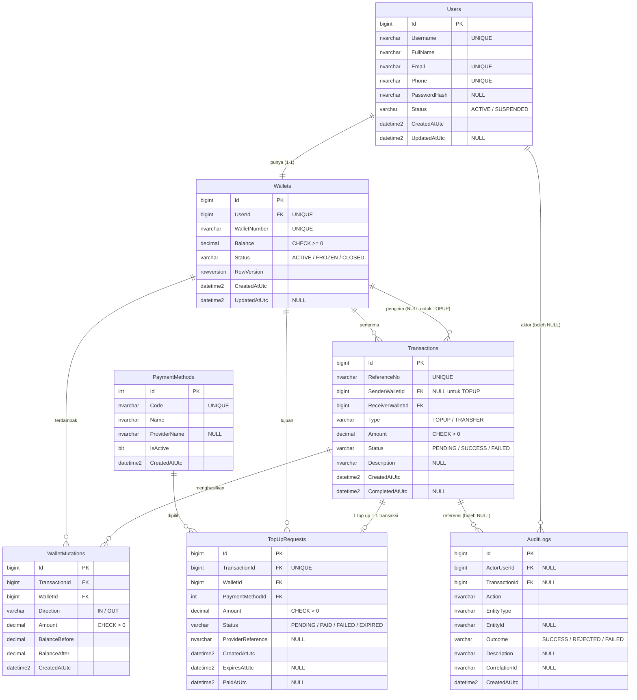

# Koda E-Wallet -Weekly 6

Melanjutkan Weekly 5. Data access diganti dari ADO.NET ke EF Core (SQL Server), hanya Web API tanpa MVC.
Fitur inti Weekly 5 (kelola user, info wallet, top up, transfer, riwayat) tetap ada, ditambah metode pembayaran,
top up dua tahap (PENDING -> PAID), mutasi saldo, audit log, dan deteksi konflik dengan `RowVersion`.

Stack: ASP.NET Core .NET 10, EF Core 10, SQL Server, Scalar.

## Struktur

```
Controllers/   endpoint HTTP
Services/      aturan bisnis, database transaction, audit log
Repositories/  query EF Core (LINQ), AsNoTracking, projection ke DTO
Models/        Entity (7 tabel) + konstanta status
Data/          AppDbContext, Fluent API di configure + DbSeeder
DTOs/          Request / Response
Exceptions/    exception bisnis + GlobalExceptionHandler
Migrations/    migration EF Core
```

## ERD



Constraint dan index lengkap ada di `Data/AppDbContext.cs` (Fluent API), termasuk CHECK saldo >= 0, nominal > 0,
bentuk TOPUP/TRANSFER, konsistensi mutasi IN/OUT, UNIQUE, dan index histori.

## Cara Menjalankan

Butuh: .NET SDK 10, SQL Server, dan tool `dotnet-ef` (`dotnet tool install --global dotnet-ef`).

1. Connection string. Ubah `ConnectionStrings:Default` di `appsettings.json` (nama database: `KodaEWalletWeekly6`).
   Jika memakai user-secrets, perbarui juga di sana karena user-secrets menimpa appsettings:
   ```
   dotnet user-secrets set "ConnectionStrings:Default" "Server=localhost;Database=KodaEWalletWeekly6;User Id=sa;Password=...;TrustServerCertificate=True" --project KodaEWallet
   ```
2. Migration (dijalankan sekali dari folder repo):
   ```
   dotnet ef migrations add InitialWeekly6 --project KodaEWallet
   dotnet ef database update --project KodaEWallet
   ```
3. Jalankan (mode Development: migration diterapkan otomatis dan seeder jalan jika database masih kosong):
   ```
   dotnet run --project KodaEWallet
   ```
4. Buka Scalar di `http://localhost:5063/scalar`. Contoh request ada di `requests.http`.

Database Weekly 5 (`KodaEWallet`) tidak disentuh karena Weekly 6 memakai database baru.

## Seeding

`DbSeeder` berjalan lewat Service yang sama dengan API, jadi saldo akhir pasti sesuai transaksi yang berhasil.

- 2 metode pembayaran: `BANK_TRANSFER`, `QRIS`
- 10 user (andi..joko) dengan wallet `WAL001`..`WAL010`, saldo awal Rp0
- 4 top up berhasil, 3 transfer berhasil, 1 top up PENDING (Fitri, TopUpRequestId 5, saldo belum berubah)

| Wallet | Nama | Perhitungan | Saldo akhir |
|---|---|---|---|
| WAL001 | Andi | +500.000 top up, +300.000 dari Citra | Rp800.000 |
| WAL002 | Budi | +350.000 top up, -50.000 ke Citra | Rp300.000 |
| WAL003 | Citra | +600.000 top up, -300.000 ke Andi, +50.000 dari Budi | Rp350.000 |
| WAL004 | Rizal | +250.000 top up, -100.000 ke Eko | Rp150.000 |
| WAL005 | Eko | +100.000 dari Rizal | Rp100.000 |
| WAL006-010 | Fitri..Joko | belum ada transaksi berhasil | Rp0 |

## Daftar Endpoint

| Method | Endpoint | Keterangan |
|---|---|---|
| GET | `/api/v1/users` | Semua user |
| GET | `/api/v1/users/{id}` | Detail user |
| POST | `/api/v1/users` | Buat user + wallet ACTIVE saldo Rp0 otomatis |
| PUT | `/api/v1/users/{id}` | Ubah nama, email, telepon |
| GET | `/api/v1/wallets/{userId}` | Info wallet (pemilik, nomor, saldo, status) |
| GET | `/api/v1/paymentMethods` | Metode pembayaran aktif |
| POST | `/api/v1/wallets/{userId}/topups` | Ajukan top up (PENDING, saldo belum berubah) |
| POST | `/api/v1/topups/{id}/confirm` | Simulasi konfirmasi pembayaran (hanya Development/Testing) |
| POST | `/api/v1/transfers` | Transfer antar-wallet |
| GET | `/api/v1/users/{id}/transactions` | Histori transaksi (search, filter, sort, pagination) |
| GET | `/api/v1/users/{id}/mutations` | Histori mutasi saldo (parameter sama) |
| GET | `/api/v1/auditLogs` | Audit log terbaru (`page`, `pageSize`) |

Parameter histori: `search` (ReferenceNo), `type` (TOPUP/TRANSFER), `status` (PENDING/SUCCESS/FAILED),
`direction` (IN/OUT), `dateFrom`, `dateTo`, `sortBy` (createdAt/amount), `sortDir` (asc/desc), `page`, `pageSize` (1-100).

Status code (format ProblemDetails dari `GlobalExceptionHandler`):

| Kasus | Status |
|---|---|
| Input tidak valid, transfer ke diri sendiri, wallet tidak ACTIVE | 400 |
| User / wallet / top up / metode pembayaran tidak ditemukan | 404 |
| Username/email/telepon duplikat, top up sudah diproses, konflik RowVersion | 409 |
| Saldo tidak mencukupi | 422 |
| Error server / database | 500 |

## Perbedaan Transactions, WalletMutations, AuditLogs

| Tabel | Menjawab pertanyaan | Isi |
|---|---|---|
| **Transactions** | "Apa yang terjadi?" | Satu baris per peristiwa uang (top up atau transfer): referensi, pengirim, penerima, nominal, status. |
| **WalletMutations** | "Bagaimana saldo setiap wallet berubah?" | Satu baris per wallet yang terdampak, dengan saldo sebelum dan sesudah. Transfer = 2 baris (OUT dan IN), top up = 1 baris (IN). |
| **AuditLogs** | "Siapa melakukan apa dan apa hasilnya?" | Jejak aktivitas, **termasuk yang ditolak** (REJECTED) dan tidak pernah menjadi Transaction. Tidak menyimpan data sensitif. |

## Alasan Teknis

- AsNoTracking: query baca-saja (histori, info wallet, daftar) tidak akan diubah, jadi EF tidak perlu memantau
  perubahannya. Hasilnya lebih ringan dan cepat. Query yang akan mengubah saldo sengaja tetap memakai tracking.
- Database transaction: top up dikonfirmasi dan transfer mengubah beberapa tabel sekaligus (saldo, status, mutasi, audit).
  Dibungkus satu transaksi agar berhasil semua atau batal semua, tidak ada saldo berubah tanpa mutasi.
  Pembuatan user + wallet juga begitu: tanpa transaksi bisa ada user tanpa wallet.
- **RowVersion**: kolom ROWVERSION di Wallets berubah otomatis setiap baris diubah. Saat menyimpan, EF menulis
  `UPDATE ... WHERE Id = @id AND RowVersion = @versiLama`. Jika wallet sudah diubah proses lain, baris tidak cocok,
  EF melempar `DbUpdateConcurrencyException`, transaksi dibatalkan, dan API menjawab 409. Ini mencegah saldo
  tertimpa (lost update) tanpa mengunci tabel.

## Hasil Testing

Isi kolom hasil setelah menjalankan `requests.http` / Swagger, lalu tempel screenshot ke folder `Screenshots/`.

| No | Skenario | Yang diharapkan | Hasil |
|---|---|---|---|
| 1 | GET payment-methods | 200, 2 metode aktif | |
| 2 | POST users valid | 201, wallet ACTIVE saldo 0 | |
| 3 | POST users duplikat | 409 | |
| 4 | Ajukan top up | 200, status PENDING, saldo wallet belum berubah | |
| 5 | Konfirmasi top up | 200, PAID, saldo naik, 1 mutasi IN, audit TOPUP_PAID | |
| 6 | Konfirmasi ulang top up yang sama | 409, saldo tidak bertambah lagi | |
| 7 | Transfer valid | 200, 1 Transaction + 2 mutasi (OUT dan IN), audit TRANSFER_CREATED | |
| 8 | Transfer melebihi saldo | 422, saldo tidak berubah, audit TRANSFER_REJECTED | |
| 9 | Transfer ke wallet tidak ada / diri sendiri | 404 / 400, audit TRANSFER_REJECTED | |
| 10 | Histori transaksi: search, filter, sort | Hanya data sesuai filter | |
| 11 | Pagination `page`, `pageSize` | `totalCount`, `totalPages`, `items` benar | |
| 12 | Histori mutasi | Saldo sebelum / sesudah berurutan benar | |
| 13 | Audit logs | 4 jenis aksi tercatat, tanpa data sensitif | |
| 14 | Konflik concurrency (lihat `requests.http` bagian akhir) | 409, tidak ada partial update | |
| 15 | Rollback | Setelah error, saldo, mutasi, dan status top up tidak berubah | |

## Screenshot

- **Scalar** / API testing
- Saldo sebelum dan sesudah transaksi
- Histori mutasi
- Audit logs
- Rollback
- Concurrency (409)
- Pagination
